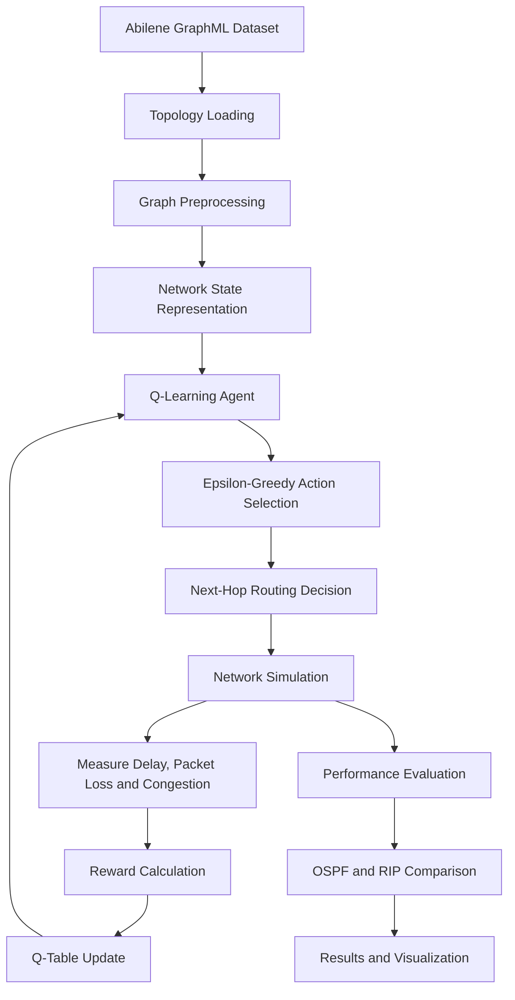
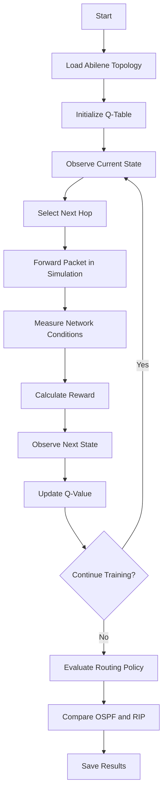

# Smart Network Packet Router Using Q-Learning

An adaptive network routing system using reinforcement learning to learn routing decisions based on network conditions.

## Project Overview

This project implements a Q-learning-based packet routing approach using the Abilene network topology. It explores adaptive routing decisions based on queue length, link delay, bandwidth utilization, and congestion.

Unlike traditional routing approaches that rely on predefined link costs or hop counts, the Q-learning agent learns routing policies through rewards and penalties.

The objective is to reduce network delay and packet loss while improving throughput and packet delivery ratio.

## Objectives

- Analyze the Abilene network topology.
- Represent network nodes and links using NetworkX.
- Convert network conditions into discrete states.
- Implement Q-learning for adaptive next-hop selection.
- Apply epsilon-greedy exploration.
- Update the Q-table using the Bellman equation.
- Evaluate routing performance against OSPF and RIP.
- Save routing results and Q-table values for analysis.

## Technologies Used

- Python
- NumPy
- NetworkX
- Matplotlib
- Q-learning
- GraphML
- Jupyter Notebook

## System Architecture



### Architecture Components

**1. Network Topology**

The Abilene GraphML dataset represents the network topology, including nodes and links.

**2. Graph Preprocessing**

NetworkX loads and processes the topology. Relevant network parameters include capacity, delay, queue length, and utilization.

**3. State Representation**

Network conditions are converted into discrete state variables:

`(q, d, u, c)`

Where `q` represents queue condition, `d` represents delay, `u` represents utilization, and `c` represents congestion.

**4. Q-Learning Agent**

The agent maintains a Q-table containing values for state-action pairs and uses these values to select routing actions.

**5. Action Selection**

An epsilon-greedy strategy balances exploration of alternative next hops with exploitation of learned routing decisions.

**6. Reward Calculation**

The reward function penalizes undesirable network conditions, including delay, packet loss, and congestion.

**7. Performance Evaluation**

The learned routing policy is compared with OSPF and RIP using network performance metrics.

## Q-Learning Workflow



### Workflow Steps

1. Load the Abilene network topology.
2. Preprocess the graph and initialize network parameters.
3. Initialize the Q-table.
4. Observe the current network state.
5. Select an available next hop using epsilon-greedy selection.
6. Simulate packet forwarding.
7. Measure delay, packet loss, and congestion.
8. Calculate the reward.
9. Update the Q-table.
10. Repeat training while gradually reducing exploration.
11. Evaluate the learned routing policy.
12. Compare routing performance and record results.

## Q-Learning Algorithm

Q-learning is a model-free reinforcement learning algorithm that learns the expected value of selecting an action in a particular state.

The Q-value update equation is:

\[
Q(s,a) \leftarrow Q(s,a) + \alpha \left[r + \gamma \max_{a'} Q(s',a') - Q(s,a)\right]
\]

Where:

- `s` — current state
- `a` — selected action
- `r` — reward received
- `s'` — next state
- `α` — learning rate
- `γ` — discount factor

### Research Parameters

| Parameter | Value |
|---|---:|
| Learning rate (α) | 0.1 |
| Discount factor (γ) | 0.9 |
| Initial exploration rate (ε) | 0.30 |
| Final exploration rate | 0.01 |
| Training episodes | 200 |
| Packets per training episode | 150 |
| Evaluation packets | 500 |
| Independent evaluation runs | 30 |

These parameters are taken from the research paper and should be checked against the actual notebook implementation.

### Epsilon-Greedy Strategy

- **Exploration:** Select a random available next hop.
- **Exploitation:** Select the next hop with the highest Q-value.

The exploration rate is reduced during training to encourage greater use of learned routing decisions.

### Reward Function

The research design uses a reward function that penalizes delay, packet loss, and congestion:

\[
r = -(w_d d + w_l l + w_c c)
\]

Where `d`, `l`, and `c` represent delay, packet-loss, and congestion penalties, respectively. The weights determine their relative importance.

## Dataset: Abilene Network Topology

The project uses `Abilene.graphml`, a GraphML representation of the Abilene network.

GraphML stores graph structure and associated node and edge attributes. The topology is loaded and analyzed using NetworkX.

```python
import networkx as nx

file_path = "Abilene.graphml"
G = nx.read_graphml(file_path)

print("Number of nodes:", G.number_of_nodes())
print("Number of edges:", G.number_of_edges())
```

The dataset should be available in the same working directory as the notebook when using the relative path shown above.

## Repository Structure

```text
Q-Learning-based-router/
│
├── Smart_Network_Packet_Router.ipynb
├── Abilene.graphml
├── Abilene.graphml.txt
├── abilene_q_table.csv
├── abilene_routing_results.csv
└── README.md
```

### Main Files

| File | Description |
|---|---|
| `Smart_Network_Packet_Router.ipynb` | Main notebook containing the routing implementation |
| `Abilene.graphml` | Network topology dataset |
| `abilene_q_table.csv` | Saved Q-table data |
| `abilene_routing_results.csv` | Routing results |
| `README.md` | Project documentation |

The `.ipynb_checkpoints` files generated by Jupyter are optional and are not required for normal project use.

## Performance Evaluation

The research paper evaluates the Q-learning router against OSPF and RIP using the following metrics:

| Metric | Description |
|---|---|
| Average end-to-end delay | Average packet delivery time |
| Packet loss rate | Percentage of packets not successfully delivered |
| Throughput | Amount of data delivered per unit of time |
| Packet delivery ratio (PDR) | Percentage of packets successfully delivered |
| Jitter | Variation in packet delay |

### Results Reported in the Research Paper

| Metric | OSPF | RIP | Q-Learning Router |
|---|---:|---:|---:|
| Average end-to-end delay (ms) | 45.2 | 52.1 | 28.4 |
| Packet loss rate (%) | 4.8 | 6.3 | 1.9 |
| Throughput (Mbps) | 620 | 580 | 785 |
| Packet delivery ratio (%) | 95.2 | 93.7 | 98.1 |
| Jitter (ms) | 8.4 | 9.7 | 4.1 |

*These values are reported in the research paper and have not been independently verified against the current GitHub notebook.*

### Reported Findings

According to the paper, the Q-learning approach achieved:

- Approximately 37% lower average delay than OSPF.
- Approximately 45% lower average delay than RIP.
- Approximately 60% lower packet loss than OSPF.
- Higher reported throughput and packet delivery ratio.

Actual results depend on the implementation, simulation settings, and evaluation conditions.

## Expected Outputs

Depending on the notebook implementation, the project may produce:

- Network topology visualizations.
- Q-learning training information.
- Learned Q-table values.
- Routing simulation results.
- Performance comparison tables.
- Graphs comparing OSPF, RIP, and Q-learning.
- CSV files containing routing results.

## Applications

- Adaptive network routing research
- Congestion-aware packet forwarding
- Reinforcement learning experiments
- Network simulation and performance analysis
- Comparison of intelligent and traditional routing methods

## Future Enhancements

- Introduce dynamic traffic patterns.
- Improve congestion-aware reward design.
- Evaluate alternative exploration strategies.
- Test larger network topologies.
- Add interactive network visualization.
- Expand performance comparisons.
- Explore integration with software-defined networking.

## Authors

Lakshith, Rahul, Ranadeep, and Sushama Rani Dutta

Department of Computer Science and Engineering  
Koneru Lakshmaiah Education Foundation, Hyderabad

GitHub: [reddylakshith328-cloud](https://github.com/reddylakshith328-cloud)

## Research Reference

**Smart Network Packet Router using Q-Learning**

The accompanying research paper describes the system architecture, Q-learning workflow, experimental design, performance metrics, and comparison with OSPF and RIP.
